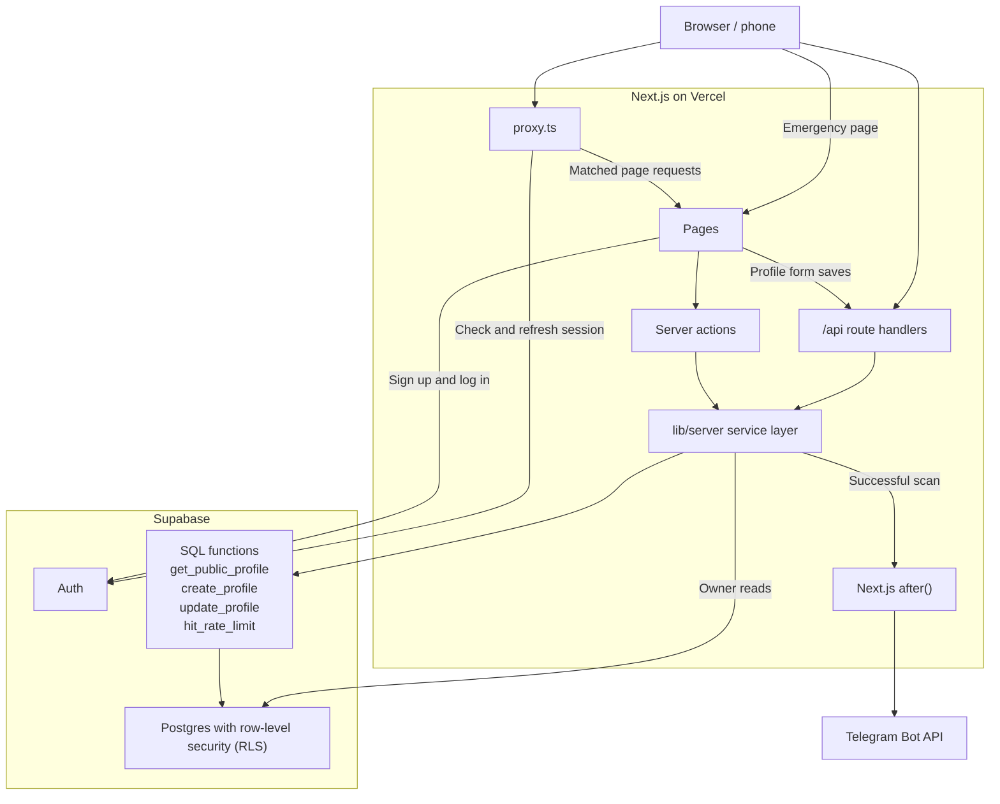

# Emergency Health Card

A QR-based medical ID. A family creates a health profile for a person, prints a card with a QR code, and anyone who scans it in an emergency sees the key medical details instantly, with no login. The family is alerted when the card is scanned.

> **Disclaimer:** This is a demonstration project, not a medical device. It uses fake data only and must not be used for real medical decisions.

## The problem
In an emergency (an accident, a collapse, or a confused elderly person found outside), responders often don't know the person's allergies, conditions, medicines, or who to call. Wallet cards get lost or go out of date, and a locked phone can't be read.

## Features
- Sign up and log in
- Dashboard listing all profiles, with edit, view QR, and download card actions
- Profile form with validation: name, age, blood group, allergies, conditions, medicines, doctor, and up to 3 emergency contacts
- Per-field privacy: the owner chooses which details appear on the public page (name, blood group, and contacts are always shown)
- Public emergency page with large text, blood group and allergies highlighted, and one-tap call buttons
- Printable card with a QR code
- Loading, error, and not-found screens, and a mobile-friendly layout

## Screenshots
| Login | Dashboard |
|---|---|
|  |  |

| Profile form | Public emergency page |
|---|---|
|  |  |

| Printable card | QR page |
|---|---|
|  |  |

## Tech stack
Next.js (App Router), TypeScript, Tailwind CSS. Backend: Supabase (auth and database), deployed on Vercel.

## Frontend structure
```
app/
  login, signup        sign-in pages
  dashboard            list of profiles
  profile/new          create a profile
  profile/[id]/edit    edit a profile
  qr/[id]              QR view
  card/[id]            printable card
  e/[token]            public emergency page (no login)
components/            ProfileForm, PrintButton, Logo
lib/api.ts             the single data layer (mock now, real APIs later)
docs/api.md            API contract between frontend and backend
```

All data access goes through `lib/api.ts`, so connecting the real backend means changing that one file.

## Running locally
```bash
git clone https://github.com/Hassancoding010/Placement_Project
cd Placement_Project
```

Complete the [Supabase and environment setup](#setup), then run:

```bash
npm install
npm run dev
```
Open http://localhost:3000.

## Backend architecture



- **Shared service layer.** Page reads go through `lib/api.ts` and server actions, while the profile form saves through the API. The server actions and API handlers use the same backend services.
- **Database access follows ownership.** Owner requests use a Supabase session cookie and the publishable key. Postgres row-level security (RLS) enforces ownership. `proxy.ts` refreshes sessions and redirects signed-out users from protected pages.
- **Public lookup by QR token.** `get_public_profile` uses `SECURITY DEFINER` to read the matching profile and record the scan. It returns only fields allowed for public display, and the TypeScript service filters the response again.
- **Atomic saves.** `create_profile` and `update_profile` save the profile and its contacts in one database transaction. They use `SECURITY INVOKER`, so the caller's RLS policies still apply.
- **Shared rate limit.** Postgres stores the counts so all Vercel instances share them. The app calls `hit_rate_limit` with the server-only Supabase secret key and checks the limit before looking up the token or logging a scan.
- **Telegram runs after the response.** Next.js `after()` schedules the alert on a successful lookup. The emergency page can render without waiting for Telegram.
- **QR and PDF generation runs in-process.** The owner-only handlers use `qrcode` to create a PNG and `pdf-lib` to build a downloadable card with the QR embedded. The QR points to `/e/<public_token>` on `NEXT_PUBLIC_SITE_URL`, or the request origin if that variable is blank.

## Backend folder structure

```text
.
├── proxy.ts                         Refreshes sessions and redirects protected page requests
├── .env.example                     Lists the app's environment variables
├── app/
│   ├── api/
│   │   ├── profile/route.ts         Lists and creates profiles
│   │   ├── profile/[id]/route.ts    Reads and updates one profile
│   │   ├── public/[token]/route.ts  Serves the public profile as JSON
│   │   ├── qr/[id]/route.ts         Serves the owner's QR image
│   │   └── card/[id]/route.ts       Downloads the owner's PDF card
│   └── auth/signout/route.ts        Signs out and redirects to login
├── lib/
│   ├── api.ts                       Connects pages and forms to the backend
│   ├── http.ts                      Builds JSON error responses
│   ├── public-view.ts               Filters and adapts the public profile
│   ├── telegram.ts                  Formats and sends scan alerts
│   ├── token.ts                     Generates random public tokens
│   ├── validation.ts                Validates and normalizes profile input
│   ├── server/
│   │   ├── card-pdf.ts              Draws the printable card
│   │   ├── profile-http.ts          Checks API sessions and reads profile input
│   │   ├── profiles.ts              Reads profiles and calls Supabase SQL functions
│   │   ├── qr.ts                    Builds emergency URLs and QR images
│   │   ├── queries.ts               Server actions for page reads
│   │   ├── rate-limit.ts            Resolves the client IP and checks its bucket
│   │   └── view-public-profile.ts   Checks the limit, looks up the token, and schedules the alert
│   └── supabase/
│       ├── admin.ts                 Server-only client for the rate-limit call
│       ├── client.ts                Browser client for signup and login
│       └── server.ts                Server client with the user's session cookies
├── supabase/migrations/
│   ├── 0001_init.sql                Creates tables, RLS policies, and SQL functions
│   └── 0002_rate_limit_lockdown.sql Restricts the rate-limit function to the service role
├── vitest.config.ts                 Configures the test runner and import alias
└── smoke.test.ts                    Checks that the app import alias resolves
```

Route and library tests sit beside the files they exercise as `*.test.ts`. `lib/server/profiles.test-support.ts` provides a fake Supabase client for tests.

## Setup

1. Create a Supabase project. In its **SQL Editor**, run [0001_init.sql](supabase/migrations/0001_init.sql) first, then [0002_rate_limit_lockdown.sql](supabase/migrations/0002_rate_limit_lockdown.sql).
2. Copy [`.env.example`](.env.example) to `.env.local` and fill in the values below. Use the project's **Connect** dialog or **Settings → API Keys** to get the Supabase credentials. [Supabase API keys](https://supabase.com/docs/guides/getting-started/api-keys)
3. For scan alerts, send `/newbot` to `@BotFather` and save the bot token in `.env.local`. Open your new bot's chat, tap **Start**, and send a message. From a local terminal, call `getUpdates` with the token and copy `result[].message.chat.id` from your message into `TELEGRAM_CHAT_ID`. [Bot setup](https://core.telegram.org/bots/tutorial), [getUpdates](https://core.telegram.org/bots/api#getupdates)

   ```bash
   curl "https://api.telegram.org/bot<YOUR_BOT_TOKEN>/getUpdates"
   ```

| Variable | Where to get the value | Exposure |
| --- | --- | --- |
| `NEXT_PUBLIC_SUPABASE_URL` | Supabase **Connect** dialog, project URL | Public |
| `NEXT_PUBLIC_SUPABASE_PUBLISHABLE_KEY` | Supabase publishable key (`sb_publishable_…`) | Public |
| `SUPABASE_SECRET_KEY` | Supabase secret key (`sb_secret_…`), used to enable rate limiting | Secret |
| `NEXT_PUBLIC_SITE_URL` | `http://localhost:3000` locally, your production origin on Vercel | Public |
| `TELEGRAM_BOT_TOKEN` | `@BotFather` after `/newbot` | Secret, server only |
| `TELEGRAM_CHAT_ID` | `message.chat.id` from `getUpdates` | Private, server only |

Telegram is optional. The app skips sending alerts if either Telegram value is blank.

For instant demo signups, optionally turn off **Confirm email** under **Authentication → Sign In / Providers → Email**. With confirmation on, signup prompts the user to check their email when Supabase returns no session. [Supabase Auth settings](https://supabase.com/docs/guides/auth/auth-email-templates)

From the repository root, run `npm install`, then `npm run dev`. Open `http://localhost:3000`. Run `npm test` in a separate terminal.

## API reference

Protected routes use the Supabase session cookie. See [docs/api.md](docs/api.md) for full request and response shapes.

| Method | Path | Auth | Success response | Handled errors |
| --- | --- | --- | --- | --- |
| `GET` | `/api/profile` | Signed in | `200` array of profile summaries | `401` |
| `POST` | `/api/profile` | Signed in | `201` with `id` and `public_token` | `400`, `401` |
| `GET` | `/api/profile/[id]` | Owner | `200` full profile | `401`, `404` |
| `PUT` | `/api/profile/[id]` | Owner | `200` full updated profile | `400`, `401`, `404` |
| `GET` | `/api/public/[token]` | None | `200` public profile | `404`, `429` |
| `GET` | `/api/qr/[id]` | Owner | `200` PNG image | `401`, `404` |
| `GET` | `/api/card/[id]` | Owner | `200` PDF attachment | `401`, `404` |
| `POST` | `/auth/signout` | Session cookie if present | `303` redirect to `/login` | No explicit error response |

Handled API errors use `{ "error": "Message" }`. `400` means invalid input, `401` means no valid session, and `404` means the profile could not be found or is outside the signed-in user's access. `429` means the public request limit was reached. Unexpected backend failures can produce `500` responses.

Create a fake profile and copy the token from its QR link. Run these examples in Bash, replacing `YOUR_PROFILE_TOKEN`. The successful lookup records a scan and sends an alert if Telegram is configured.

```bash
BASE_URL=http://localhost:3000
curl -i "$BASE_URL/api/public/YOUR_PROFILE_TOKEN"
curl -i "$BASE_URL/api/public/no-such-token"

# With the Supabase secret configured, run within a single 60-second window.
# Unknown tokens count toward the limit and do not send scan alerts.
for i in {1..21}; do
  curl -sS -o /dev/null -w '%{http_code}\n' "$BASE_URL/api/public/no-such-token"
done
```

In a fresh window, the loop returns 20 `404` responses followed by a `429`. Earlier lookups from the same IP can make the `429` appear sooner.

## Security notes

- **RLS policies.** Signed-in users can access their own profiles and the contacts linked to those profiles. They can read scan logs for their own profiles. The public lookup function writes scan logs, and `rate_limits` has RLS enabled with no client access policies.
- **Public data.** The public response always includes name, age, blood group, and contacts. Allergies, conditions, medicines, and doctor name are included only when their visibility flags are on. Public responses never include the owner ID, account email, database IDs, or the token itself. The “Always public” line in [docs/api.md](docs/api.md) omits age, which the response and emergency page both include.
- **QR token.** Each `public_token` contains 192 bits from Node's cryptographic random generator, encoded as 32 base64url characters. Anyone with the QR link can open the shared profile.
- **Input validation.** The server validates and normalizes profile saves, including age, blood group, text lengths, contact count, phone format, and visibility flags. Bad JSON or invalid input returns `400`.
- **Rate limiting.** The emergency page and public API share a limit of 20 requests per IP per 60 seconds. The API returns `429` when blocked, and the page shows a retry message. People on the same network can share a bucket. If the secret is missing or the rate-limit check fails, the app lets the lookup proceed.
- **Secrets.** Keep secrets in environment variables and never prefix them with `NEXT_PUBLIC_`. The app uses `SUPABASE_SECRET_KEY` only for the `hit_rate_limit` call through `lib/supabase/admin.ts`, which imports `server-only`. The second migration grants execution to `service_role` and revokes it from `PUBLIC`, `anon`, and `authenticated`. Git ignores `.env*` except the tracked `.env.example`.
- **Demo limits.** All alerts go to the single configured `TELEGRAM_CHAT_ID`. Use fake data only. This demo must never be used for real medical decisions.

## Deployment (Vercel)

1. Import the repository into Vercel with the Next.js preset, or run `vercel link` from the repository root to create or link a project. For Git deployments, choose the branch that contains the backend as the production branch. [Git deployments](https://vercel.com/docs/git), [CLI deployments](https://vercel.com/docs/projects/deploy-from-cli)
2. Under **Settings → Environment Variables**, add all six names from [`.env.example`](.env.example) for **Production**, using the Supabase and Telegram values from [Setup](#setup). Set `NEXT_PUBLIC_SITE_URL` to the production HTTPS URL so the QR codes open the deployed site. The Telegram values can be left unset for a demo without alerts. [Vercel environment variables](https://vercel.com/docs/environment-variables)
3. In Supabase, set **Authentication → URL Configuration → Site URL** to the same production URL. [Supabase redirect URLs](https://supabase.com/docs/guides/auth/redirect-urls)
4. Deploy the production branch through the Git integration or run `vercel deploy --prod` from the linked project directory. If Vercel already deployed before the environment variables were added, redeploy to apply them. [Vercel deployments](https://vercel.com/docs/deployments)
5. Sign in on the deployed site, create a fake profile, and scan its QR code with a phone. Confirm that the emergency page opens at the production URL without signing in, shows the expected public fields, and sends a Telegram alert when configured.

Live demo: `<add URL>`

## Testing

Run `npm test` from the repository root. Vitest covers profile validation, token generation, public-field filtering, page adapters, profile queries and saves, rate-limit decisions, and Telegram formatting and scheduling. Route tests check JSON responses, auth failures, missing profiles, rate limiting, QR PNGs, PDF downloads, and the signout redirect.

The tests use fake Supabase responses and mock Telegram requests. The phone scan in the deployment steps checks the live services together.
